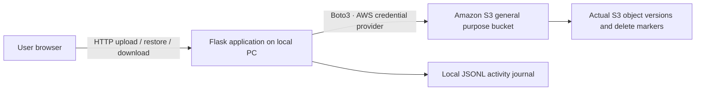

# CloudRestore

CloudRestore is a Flask application that demonstrates real Amazon S3 object versioning and recovery. The application runs locally at first; the S3 bucket and its objects are real AWS resources. No EC2 instance is required.

## Architecture



The app reads bucket configuration, version IDs, timestamps, file sizes, delete markers, versioning state, encryption status, and bucket-level Public Access Block state through AWS APIs. Dashboard version totals are marked as lower bounds if the first S3 page is truncated. Upload and restore results are logged locally only after S3 returns a successful response.

## Features

- Upload a file to S3 with a configurable size limit. Data is spooled to disk after 1 MiB rather than kept entirely in memory.
- Store uploads with SSE-S3 and a SHA-256 digest in S3 object metadata.
- List actual S3 object versions and delete markers, including `VersionId`, `IsLatest`, timestamp, and size.
- Download a selected version only after its SHA-256 can be verified.
- Restore a previous version as a new latest object version while preserving prior versions.
- Delete the current object by adding an S3 delete marker. The app has no permanent-version-delete operation.
- Show real S3 dashboard information and a local app activity journal.

Versions created outside CloudRestore may have no comparable full-object checksum. The app will report that such content cannot be verified and will not download or restore it. Multipart composite checksums are not assumed to equal a normal SHA-256 digest.

## Requirements

- Python 3.11 or newer
- AWS account access to S3 in `ap-southeast-2` (Sydney)
- AWS CLI v2 on Windows
- A dedicated general purpose bucket with versioning enabled
- A named AWS CLI profile called `cloudrestore`, or another profile set in `.env`

## Set up AWS manually

CloudRestore does not create AWS resources. Complete these steps in the AWS Console yourself.

### 1. Check the AWS Free plan

In the console, check **Billing and Cost Management → Free Tier / Credits** for your account's plan, remaining credit, and expiry. AWS's current Free plan is limited by both credits and time; S3 storage, versions, requests, and data transfer are usage-based. Do not assume S3 is permanently free or upgrade the account to a paid plan for this project. AWS documents its current terms in [Free Tier FAQs](https://aws.amazon.com/free/free-tier-faqs/) and [S3 pricing](https://aws.amazon.com/s3/pricing/).

### 2. Create one private S3 bucket

1. In the AWS Console region selector, select **Asia Pacific (Sydney) — `ap-southeast-2`**.
2. Open **Amazon S3 → Buckets → Create bucket**.
3. Choose a globally unique lowercase bucket name, for example `cloudrestore-files-2026-<unique-suffix>`. Replace the placeholder with random lowercase letters or digits. The actual name is configured in `.env`, never hardcoded.
4. Keep **Object Ownership: ACLs disabled** and **Block all public access** enabled.
5. Under **Bucket Versioning**, select **Enable**.
6. Under **Default encryption**, choose **Server-side encryption with Amazon S3 managed keys (SSE-S3)**. SSE-S3 is also the S3 default for new objects, and the app explicitly requests AES-256 encryption for uploads/restores.
7. Create the bucket. Do not add a public bucket policy or enable website hosting.

AWS documents bucket creation and these settings in [Create a general purpose bucket](https://docs.aws.amazon.com/AmazonS3/latest/userguide/create-bucket-overview.html). Check **Properties → Bucket Versioning** and **Properties → Default encryption** afterward.

### 3. Create restricted application permissions

Create a customer-managed IAM policy scoped to only the CloudRestore bucket. Replace `BUCKET_NAME` in both resource ARNs below with the exact bucket name. Attach the policy to a dedicated IAM group/user used by the local AWS CLI profile. The policy does not permit permanent version deletion, bucket policy changes, public access, or resource creation.

```json
{
  "Version": "2012-10-17",
  "Statement": [
    {
      "Sid": "ReadCloudRestoreBucketConfigurationAndListVersions",
      "Effect": "Allow",
      "Action": [
        "s3:ListBucket",
        "s3:ListBucketVersions",
        "s3:GetBucketVersioning",
        "s3:GetEncryptionConfiguration",
        "s3:GetBucketPublicAccessBlock"
      ],
      "Resource": "arn:aws:s3:::BUCKET_NAME"
    },
    {
      "Sid": "ReadWriteCloudRestoreObjectsWithoutPermanentVersionDeletion",
      "Effect": "Allow",
      "Action": [
        "s3:GetObjectVersion",
        "s3:PutObject",
        "s3:DeleteObject"
      ],
      "Resource": "arn:aws:s3:::BUCKET_NAME/*"
    }
  ]
}
```

If you cannot create IAM users or policies in the account, ask the account administrator to do this. Do not use root-user access keys. `s3:DeleteObject` lets the app add a delete marker in a versioned bucket; the policy deliberately omits `s3:DeleteObjectVersion`.

### 4. Install and configure AWS CLI on Windows

Install the official [AWS CLI v2 for Windows](https://docs.aws.amazon.com/cli/latest/userguide/getting-started-install.html). Open a new PowerShell window and check it:

```powershell
aws --version
```

Create the `cloudrestore` profile:

```powershell
aws configure --profile cloudrestore
```

Enter the access key ID and secret access key for the restricted IAM identity, region `ap-southeast-2`, and output format `json`. Type them only into the CLI prompts; never paste them into Codex, `.env`, source files, or GitHub. AWS stores the profile under your Windows user profile, outside this project.

Confirm the selected identity and bucket configuration:

```powershell
aws sts get-caller-identity --profile cloudrestore
aws s3api head-bucket --bucket YOUR_BUCKET_NAME --region ap-southeast-2 --profile cloudrestore
aws s3api get-bucket-versioning --bucket YOUR_BUCKET_NAME --region ap-southeast-2 --profile cloudrestore
```

The versioning command should report `"Status": "Enabled"`.

### 5. Configure CloudRestore

From this project folder:

```powershell
Copy-Item .env.example .env
notepad .env
```

Set the bucket name and leave the region/profile as shown if you are using the Sydney bucket and named profile:

```dotenv
AWS_PROFILE=cloudrestore
AWS_REGION=ap-southeast-2
AWS_S3_BUCKET=your-actual-bucket-name
MAX_UPLOAD_MB=10
ACTIVITY_LOG_PATH=instance/activity.jsonl
```

Do not put credentials in `.env`. The `.env` file is ignored by Git.

### 6. Install dependencies and run locally

```powershell
py -3 -m venv .venv
.\.venv\Scripts\python.exe -m pip install -r requirements.txt
.\.venv\Scripts\python.exe app.py
```

Open `http://127.0.0.1:5000`. The app should show the S3 connection, bucket, versioning, encryption and bucket-level public access status. A field that cannot be read due to permissions is shown as unavailable rather than as zero or disabled.

## Live demonstration

1. Show the S3 bucket in the console with versioning enabled, SSE-S3 configured, and Block Public Access enabled.
2. Create `demo.txt` containing `Version 1`; upload it in CloudRestore.
3. Change the file contents to `Version 2` and upload it again using the same filename.
4. Open **History** and show the real S3 version IDs and `IsLatest` state.
5. Download the older version. CloudRestore verifies its SHA-256 before sending it to the browser.
6. Restore the older version. Confirm the app reports a successful restore only after S3 returns a new version ID; then show that new version in the history.
7. Delete the current object. S3 adds a delete marker, while previous versions remain. Use **Recover** to restore an older version as a new latest version.
8. Show the recent upload rows from S3 and the restore/download/delete activity journal maintained locally by the app.

## Tests

Run the mocked unit tests with:

```powershell
\.venv\Scripts\python.exe -m pytest -q
```

These tests use mocks and do not call AWS. They cover dashboard connectivity, bucket/versioning errors, uploads and overwrite versions, version listing, SHA-256 verification, download, restore, delete markers, recovery, and error classification. A live S3 integration run is intentionally not automatic; it requires your configured bucket and your approval because it writes object versions and delete markers.

## Cost and cleanup

- Check the account's Free plan credit/expiry and S3 usage before and after the demo. AWS free account terms and eligible usage can change.
- Keep the demo files very small and avoid repeated unnecessary uploads. Every retained S3 object version consumes storage.
- Requests and data transfer can also be billable. SSE-S3 does not require a customer-managed KMS key.
- The app can add delete markers but cannot permanently delete versions. This protects recovery data, but also means the bucket retains versions until you manually clean up the dedicated test bucket in the console.
- Do not create EC2, NAT Gateway, load balancers, or other services for the initial project. The app is local and S3-backed.

## Design notes

- **IaaS:** No IaaS resource is needed for the initial local demonstration. An EC2 deployment is an optional later extension and is deliberately not configured here.
- **PaaS:** Amazon S3 is the managed object storage service used for actual file data and versions.
- **SaaS:** AWS Management Console and GitHub are hosted services used for administration and source control, not application hosting.
- The local activity journal is operational metadata only; it is not a substitute for S3 state. S3 remains the source of truth for objects and versions.
